# Surface, Style, and Specialization: The Evolution of Play in Modern Professional Tennis

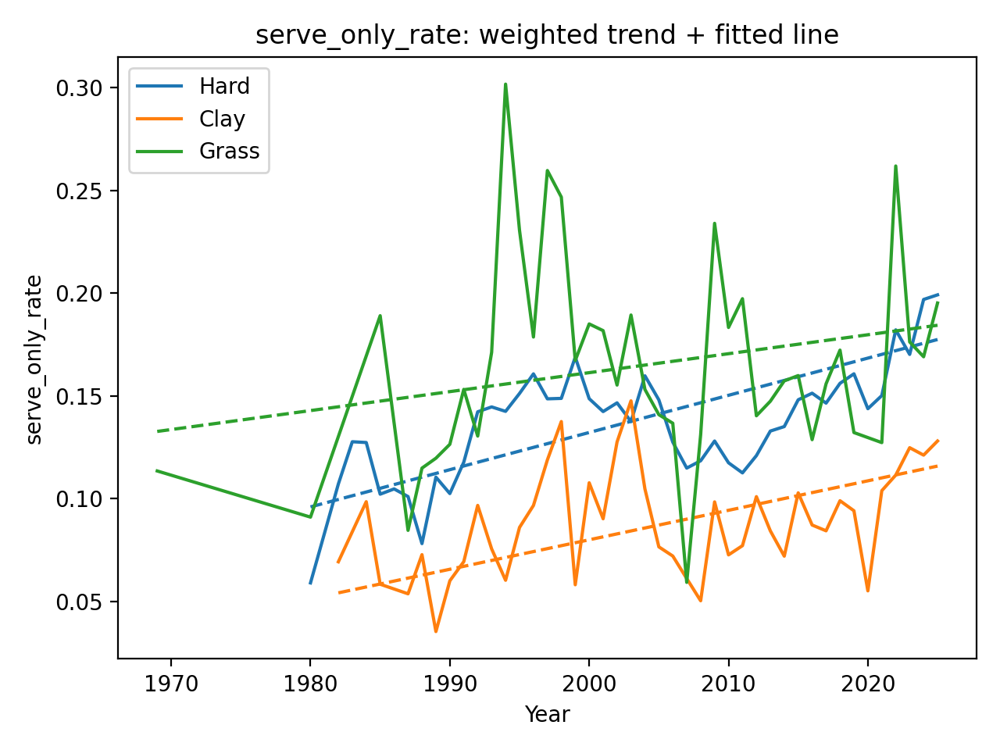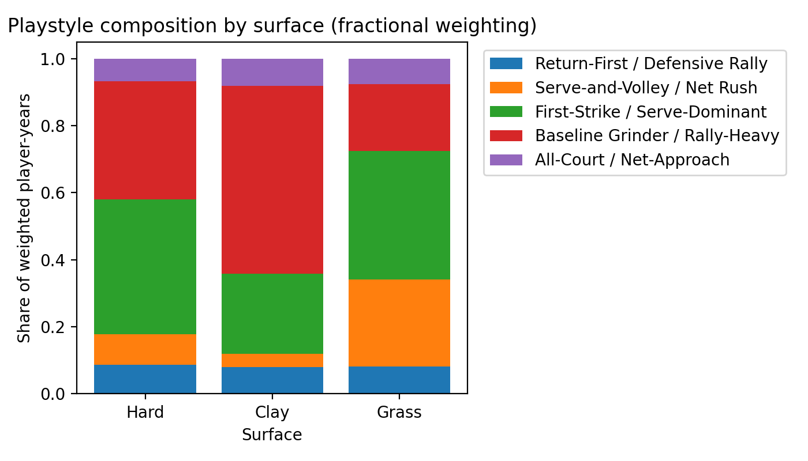

**Keywords:** professional tennis, court surfaces, serve dominance, rally structure, surface specialization, playstyle clustering, Tennis Abstract Match Charting Project, point-by-point data, K-means clustering

## Group Members
- Connor Stephen
- Gavin Greaton

## Project Overview
Professional tennis has historically been shaped by major differences across hard, clay, and grass courts. Grass has traditionally rewarded big serving and short points, while clay has favored longer rallies, heavier baseline play, and greater defensive skill. However, modern tennis may be changing. Advances in racket and string technology, evolving training methods, and possible surface homogenization raise the question of whether elite tennis is becoming both more serve-oriented and less surface-specific over time.

This project studies how men’s professional tennis has evolved from the 1980s through 2025 using match-level and point-level data from the Tennis Abstract Match Charting Project. We focus on four related questions. First, has the modern game become more serve-dominated? Second, have rally patterns changed differently across surfaces? Third, has player specialization by surface declined over time, suggesting greater all-surface adaptability? Fourth, can we identify distinct playstyle archetypes from point-level tactical data, and how have those archetypes changed across surfaces and eras?

Our findings suggest that serve dominance has increased across all major surfaces, rally structures have partially converged, and multi-dimensional surface specialization has generally declined over time. At the same time, clustering reveals that distinct tactical styles still exist, but their prevalence has shifted. Older serve-and-volley and all-court net-approach styles have declined, while baseline-heavy and first-strike serve-dominant styles have become more prominent.

## Data
Our main data source is the [Tennis Abstract Match Charting Project](https://www.tennisabstract.com/charting/meta.html), which provides standardized point-by-point charting for professional tennis matches.

We use two main data components:
- match-level metadata, including match id, players, tournament, round, surface, and date
- point-level charting data, including point number, score state, server indicator, and encoded point strings in the `1st` and `2nd` columns

We merge the point-level files with match metadata using `matchid`, then retain only the three canonical surfaces:
- Hard
- Clay
- Grass

### Coverage notes
A key limitation of the Match Charting Project is that coverage is uneven across both time and surface. Later decades contain many more charted points than earlier decades. Hard courts dominate the charted sample, while grass is much more sparsely represented. The number of unique players in the dataset also increases substantially over time.

Because of this, we use weighted aggregation and minimum-sample thresholds in downstream analysis and interpret early-era results more cautiously.

## Repository Structure

```text
.
├── data/                                     # input and processed data files
├── figures/                                  # figures used in the report and analysis
│   ├── coverage_total_points_by_surface.png
│   ├── coverage_unique_players_over_time.png
│   ├── reg_trend_serve_only_rate.png
│   ├── reg_trend_avg_rally_shots.png
│   ├── reg_trend_ace_rate.png
│   ├── boxplot_specialization_v2_combined_by_decade.png
│   ├── specialization_distribution_over_time.png
│   ├── style_silhouette_by_k.png
│   ├── style_cluster_centroid_heatmap_no_points.png
│   ├── style_cluster_share_by_surface_named.png
│   ├── style_cluster_share_over_time_named.png
│   └── additional exploratory figures
├── notebooks/                                # exploratory and development notebooks
├── outputs/                                  # intermediate and final outputs
├── scripts/                                  # data processing and analysis scripts
├── main.tex                                  # final LaTeX report
├── references.bib                            # bibliography for report
└── README.md                                 # project overview and replication guide
````

## Data Processing and Feature Engineering

The MatchChart notation stores each point as a compact encoded sequence. We parse these strings to recover interpretable point-level features.

From the point strings, we engineer:

* serve-only outcomes
* ace indicators
* serve direction when encoded
* serve-and-volley indicators
* approach-shot indicators
* rally-shot-count proxies
* point-ending markers such as winners, forced errors, and unforced errors
* point-ending style categories such as ground, slice, drop, and net finishes

These point-level features are then aggregated into player-year-surface summaries, which form the basis for our trend analysis, specialization analysis, and clustering analysis.

## Methods

### 1. Serve dominance trends

We measure serve dominance primarily using:

* **serve-only rate**: the share of service points ending immediately at the serve
* **ace rate**: the share of service points ending in aces

For each player-year-surface, we compute these metrics and then aggregate them to surface-year values using point-weighted means. We fit weighted linear regressions of each metric on calendar year separately by surface.

### 2. Rally structure trends

We measure rally structure using:

* **average rally shots**
* short-point shares
* long-point shares

These are also aggregated at the player-year-surface level and then summarized at the surface-year level using point-weighted averages.

### 3. Surface specialization

To measure how much players vary by surface, we construct a multi-dimensional feature vector for each player-year-surface using both serving and returning behavior.

We then:

1. standardize all features using z-scores
2. compute a centroid across a player’s available surface vectors
3. define specialization as the mean Euclidean distance from each surface vector to that centroid

Higher values indicate that a player’s profile changes more across hard, clay, and grass. Lower values indicate a more portable all-surface profile.

### 4. Playstyle clustering

We create standardized player-year style fingerprints from behavioral variables, excluding raw point totals so that clustering reflects style rather than sample size.

We use K-means clustering and evaluate candidate values of `k` using silhouette scores. The best-performing and most interpretable solution is `k = 5`.

We then interpret cluster centroids and label the five playstyle groups as:

* Return-First / Defensive Rally
* Serve-and-Volley / Net Rush
* First-Strike / Serve-Dominant
* Baseline Grinder / Rally-Heavy
* All-Court / Net-Approach

Finally, we examine how these cluster shares vary across surfaces and across time.

## Main Results

### Serve dominance increased over time

Serve-only rate rises across hard, clay, and grass, indicating that service points increasingly end before rallies fully develop. Ace rates also increase across all three surfaces, with hard courts moving closer to grass over time.

### Rally structures partially converged

Clay still produces the longest rallies on average, but the gap between clay and the faster surfaces narrows relative to earlier decades. Grass remains the shortest-rally surface overall.

### Surface specialization declined

Our specialization index generally falls over time. Earlier decades show higher median specialization and greater dispersion, while later decades show lower and tighter distributions. This suggests that modern players tend to be more adaptable across surfaces.

### Playstyle archetypes remain meaningful

The clustering results show that tennis is not becoming stylistically uniform. Instead, distinct tactical styles remain visible, but their prevalence has changed.

Grass has more aggressive first-strike and net-rushing styles. Clay is dominated by rally-heavy baseline play. Hard courts sit between these extremes. Over time, traditional serve-and-volley styles decline, while first-strike serve-dominant and baseline-heavy styles become more common.

## Main Figures

### Coverage diagnostics

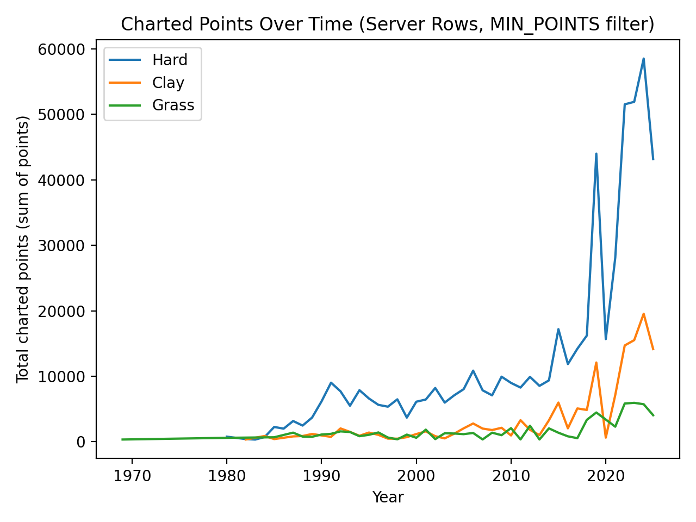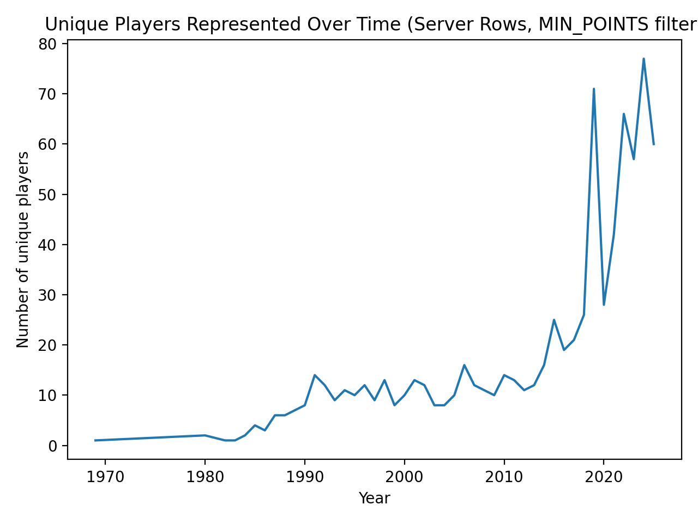

### Serve dominance and rally trends

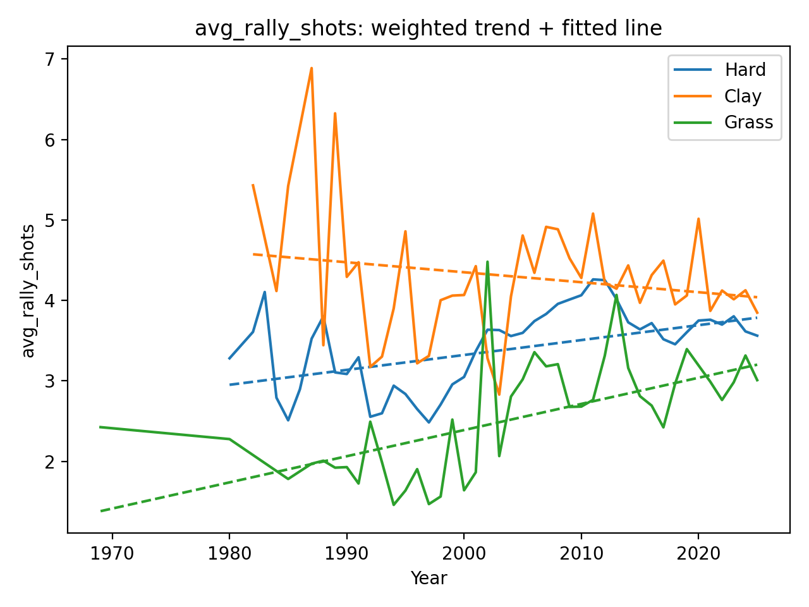

<p align="center">
  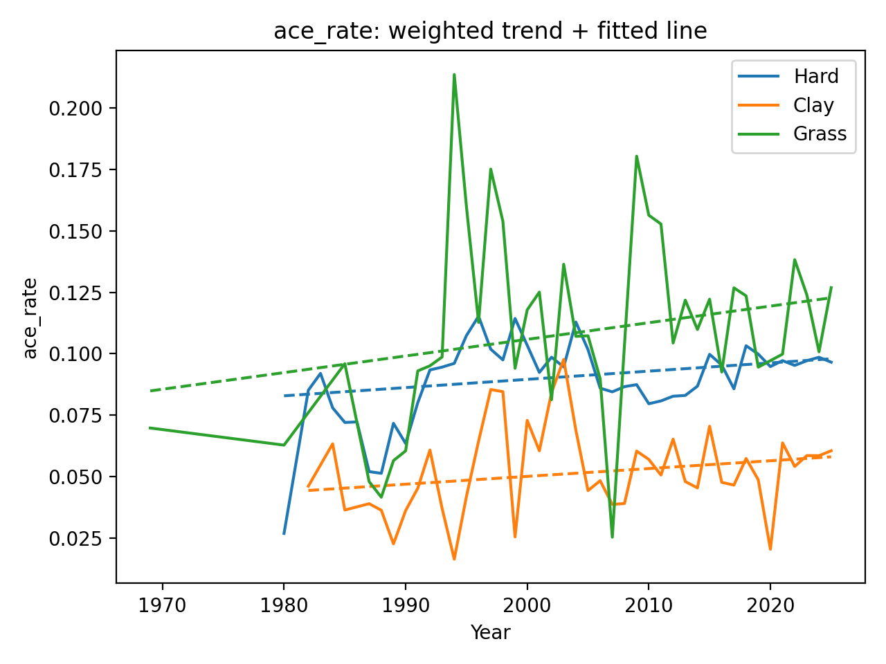
</p>

### Surface specialization

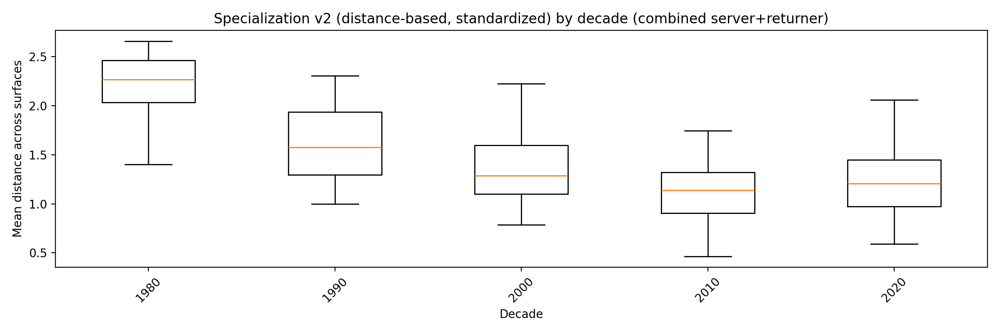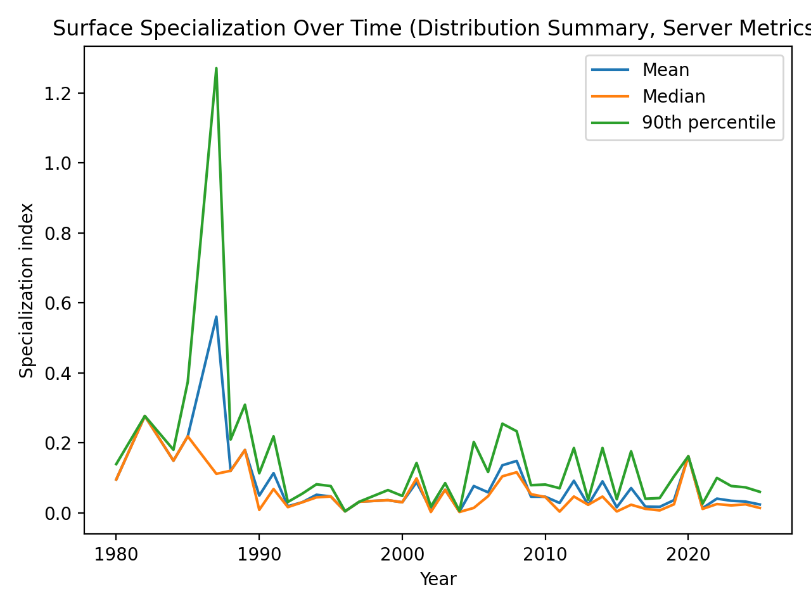

### Playstyle clustering

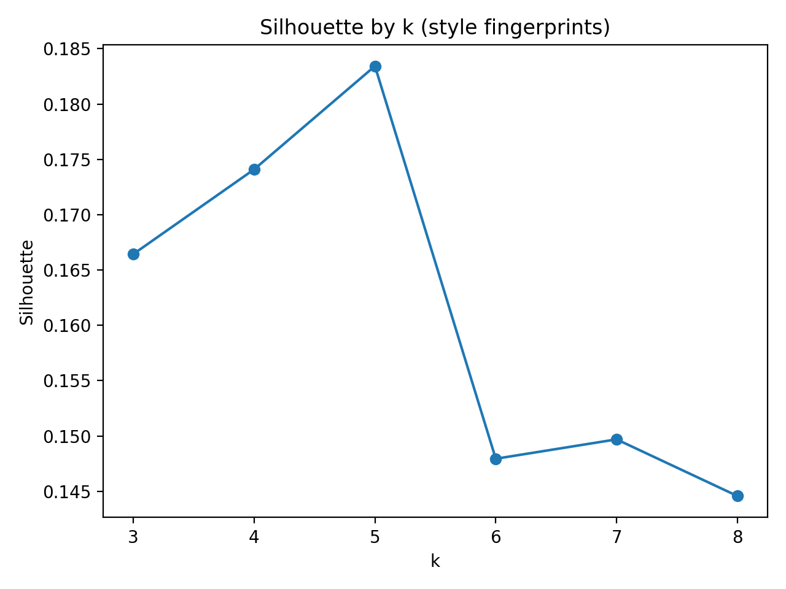

<p align="center">
  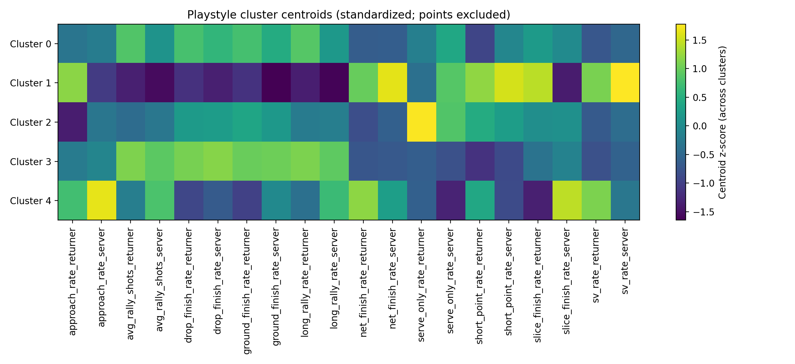
</p>

<p align="center">
  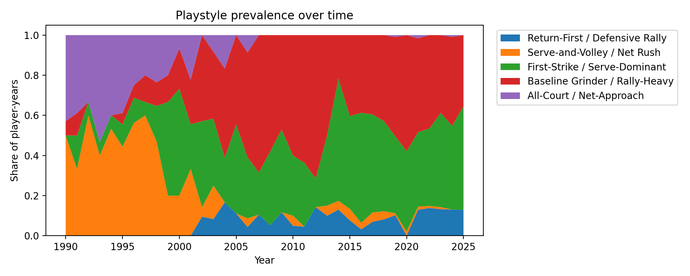
</p>

## How to Reproduce

The exact workflow depends on the scripts and notebooks in this repository, but the broad pipeline is:

1. Obtain and clean match-level and point-level charting data
2. Merge metadata and point files using `matchid`
3. Parse MatchChart point strings into structured point-level features
4. Aggregate point-level features into player-year-surface summaries
5. Compute serve dominance metrics, rally metrics, specialization indices, and style fingerprint vectors
6. Run clustering analysis on standardized player-year fingerprints
7. Generate figures for coverage diagnostics, trend regressions, specialization distributions, and clustering outputs
8. Compile the final report from `main.tex`

## Files Most Relevant for the Final Report

* `main.tex` — final project report
* `references.bib` — references used in the report
* `figures/` — figures included in the report
* `scripts/` — core processing and analysis scripts
* `notebooks/` — exploratory and development work
* `outputs/` — generated outputs used for plotting and interpretation

## Limitations

Several limitations are important to keep in mind:

* charting coverage is uneven across time and surfaces
* grass is underrepresented relative to hard courts
* early years are much more sparsely charted than recent years
* rally and tactical variables are proxies derived from encoded point strings rather than optical tracking data
* the specialization measure depends on feature selection and surface availability
* clustering is useful and interpretable, but still depends on modeling choices such as feature set and `k`

## Future Work

There are several natural extensions to this project:

* link cluster identities to specific players and eras
* compare ATP and WTA patterns
* test whether lower specialization is associated with greater competitive success
* incorporate richer tracking or biomechanical data
* expand clustering analysis to identify transitions in player style over careers

## References

* Barnett, T., & Pollard, G. (2007). *How the surface of a tennis court affects the game.* Journal of Sports Sciences, 25(3), 313–318.
* Gauriot, R., & Page, L. (2016). *Nash at Wimbledon: Evidence from half a million serves.* American Economic Journal: Microeconomics, 8(3), 235–264.
* O'Donoghue, P., & Ingram, B. (2001). *A notational analysis of elite tennis strategy.* Journal of Sports Sciences, 19(2), 107–115.
* Pluim, B. M., Jayanthi, N., et al. (2018). *Physical demands of tennis across the different court surfaces, performance levels and sexes: A systematic review with meta-analysis.* British Journal of Sports Medicine, 52(12), 792–798.
* Sackmann, J. (2015). *Tennis Abstract.* [https://www.tennisabstract.com](https://www.tennisabstract.com)
* Whiteside, D., Elliott, B., & Lay, B. (2013). *The effect of age and skill level on tennis serve technique.* Sports Biomechanics, 12(4), 362–371.

```
```
